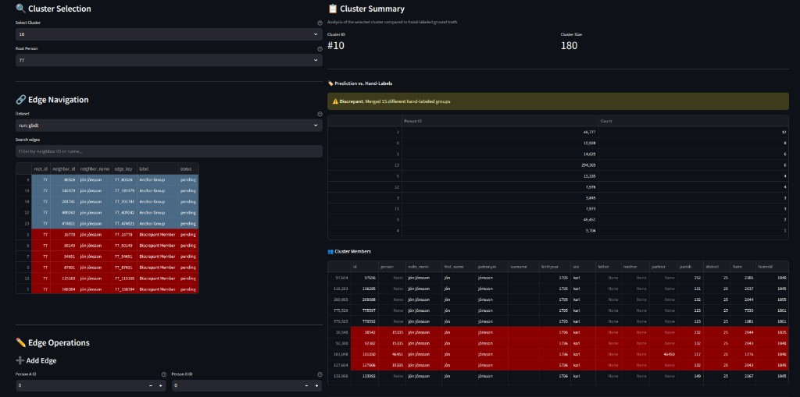
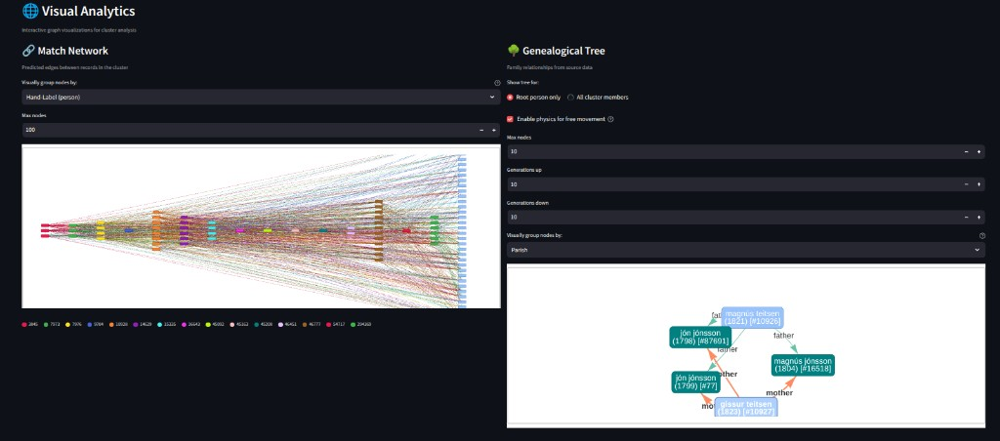

<div align="center">

# ICE-ID 2.0

**Longitudinal entity-resolution benchmark, dataset, and interactive dashboard**

[](https://creativecommons.org/licenses/by/4.0/)
[](https://www.python.org/downloads/)

Dataset + benchmark for Icelandic historical census data (1703–1920), DeepMatcher suites, multiple model families (symbolic → deep), and a Streamlit dashboard for exploration and evaluation.

[Quick Start](#-quick-start) • [Data](#-data-sources) • [Benchmarking](#-benchmarking) • [Dashboard](#-dashboard) • [Docs](#-documentation) • [Citation](#-citation)

</div>

<div align="center">
<h3>Screenshots</h3>

<p><strong>Cluster Inspector</strong> — edge navigation, cluster summary, and member details</p>



<p><strong>Visual Analytics</strong> — match network and genealogical tree visualisations</p>



</div>

---

## 📋 Table of Contents

- [Overview](#-overview)
- [What's Included](#-whats-included)
- [Quick Start](#-quick-start)
- [Data Sources](#-data-sources)
- [Benchmarking](#-benchmarking)
- [Dashboard](#-dashboard)
- [Documentation](#-documentation)
- [Repository Layout](#-repository-layout)
- [Contributing](#-contributing)
- [Citation](#-citation)
- [License](#-license)

---

## 🎯 Overview

**ICE-ID** (Icelandic Census Entity IDentification) pairs a 220-year census corpus (984k records, 226k linked persons) with a modular benchmarking stack:

- Temporal OOD protocol (train < 1870, val 1870–1890, test 1891–1920)
- 8 classic DeepMatcher datasets for cross-domain comparison
- Model zoo spanning symbolic (NARS), classical ML, deep learning, zero-shot, and LLM-based adapters
- Reproducible scripts that generate paper-ready figures/tables and dashboard-friendly artifacts

---

## 📦 What's Included

- **bench/** – Experiment runner, datasets, models, blocking, metrics, calibration, clustering
- **dashboard/** – Streamlit app for data browsing, training, scoring, and cluster inspection
- **docs/** – Architecture map, workflows, and benchmarking guide
- **papers/** – LaTeX sources for the dataset and methods papers
- **runs/** – Space for your experiment outputs

---

## 🚀 Quick Start

### 0) Prereqs
- Python 3.11+ (required by several dependencies)
- git + git-lfs (`git lfs install`)
- CUDA 12.x recommended for deep models; CPU works for NARS and classic baselines

### 1) Clone & install

```bash
git clone https://github.com/IIIM-IS/ICE-ID-2.0.git
cd ICE-ID-2.0

python -m venv .venv
source .venv/bin/activate  # Windows: .venv\\Scripts\\activate
pip install --upgrade pip
pip install -r requirements.txt
```

### 2) Fetch data

```bash
git lfs install
git clone https://huggingface.co/datasets/goldpotatoes/ice-id raw_data

# Optional: grab DeepMatcher benchmarks
python bench/scripts/prepare_data.py deepmatcher
```

### 3) Smoke test

```bash
python - <<'PY'
from bench.data.iceid import IceIdDataset
IceIdDataset(data_dir='raw_data').load()
print('ICE-ID loaded successfully')
PY
```

### 4) Run a baseline

```bash
cd bench
python scripts/run_nars_full_eval.py              # NARS on ICE-ID + DeepMatcher
# or
python -m bench.runner.run_one --config config/examples/iceid_nars.yaml
```

### 5) Launch the dashboard

```bash
cd ..
streamlit run dashboard/app.py
```

The dashboard reads `raw_data/` and `runs/` by default. To open a corrected reference
release instead, set `ICEID_RELEASE_DIR` to a release directory containing a complete
`manifest.json` and an `application_paths.json` (or place a `label-repair/pipeline_paths.json`
next to the repository that names `selected_release`).

---

## 📊 Data Sources

**ICE-ID (raw_data/)**
- `people.csv` – harmonized census records with hierarchical geography and kinship fields
- `manntol_einstaklingar_new.csv` – person IDs / cluster labels used for ground truth
- Temporal splits derived from `heimild` (census year) with the default protocol above

**DeepMatcher datasets (bench/deepmatcher_data/)**
- Downloaded via `python bench/scripts/prepare_data.py deepmatcher`
- Includes Abt-Buy, Amazon-Google, DBLP-ACM, DBLP-Scholar, Walmart-Amazon, iTunes-Amazon, Beer, Fodors-Zagats

---

## 🔬 Benchmarking

Common entry points (run from `bench/` unless noted):

- `scripts/run_nars_full_eval.py` – End-to-end evaluation of NARS across ICE-ID + DeepMatcher
- `-m bench.runner.run_one --config config/examples/iceid_nars.yaml` – Single-model run with YAML config
- `scripts/generate_paper_artifacts.py all` – Recreate paper figures/tables into `paper_artifacts/`
- `scripts/prepare_data.py deepmatcher` – Download DeepMatcher datasets only

Results land in `bench/benchmark_results/` (CSV) and `bench/paper_artifacts/` (JSON/CSV).

Metrics covered: pairwise (P/R/F1/AUC), clustering (ARI/B³), and ranking (P@k/R@k).

---

## 🖥️ Dashboard

Launch with `streamlit run dashboard/app.py` from the repo root.

Highlights:
- Explore ICE-ID and DeepMatcher tables with filtering and missingness views
- Train/evaluate available models with live logs
- Inspect confusion matrices, calibration plots, and cluster graphs
- Export predictions and cluster edits for follow-up analysis

---

## 📚 Documentation

- `QUICK_START.md` – 5-minute setup walk-through
- `docs/ARCHITECTURE.md` – Codebase map and data flow
- `docs/WORKFLOWS.md` – How-tos (add dataset/model, run ablations, compile papers)
- `docs/BENCHMARK_GUIDE.md` – Detailed benchmarking reference

---

## 🏗️ Repository Layout

```
ICE-ID-2.0/
├── bench/                # Benchmark framework, scripts, external model hooks
├── dashboard/            # Streamlit UI
├── docs/                 # Documentation set
├── papers/               # LaTeX sources for the two papers
├── raw_data/             # (after download) ICE-ID data files
├── runs/                 # Your experiment outputs
└── QUICK_START.md        # Short guide
```

---

## 🤝 Contributing

Pull requests are welcome. Please add/adjust tests for new functionality and follow the registry patterns in `bench/core/registry.py` when adding models or datasets. See `docs/WORKFLOWS.md` for step-by-step guidance.

---

## 📜 Citation

If you use ICE-ID, please cite:

```bibtex
@article{iceid2026,
  title={ICE-ID: A Benchmark for Longitudinal Entity Resolution in Historical Census Data},
  author={Hora de Carvalho, Gonçalo and Popov, Lazar S. and Kaatee, Sander and 
          Thórisson, Kristinn R. and Li, Tangrui and Björnsson, Pétur Húni and 
          Dibangoye, Jilles S.},
  year={2026}
}
```

---

## 📋 License

This project is licensed under **Creative Commons Attribution 4.0 International (CC BY 4.0)**. See `LICENSE` for details.

---

<div align="center">

Made with ❤️ by <br>
Icelandic Institute for Intelligent Machines <br>
& <br>
Centre for Digital Humanities and Arts <br>

[Report Bug](https://github.com/IIIM-IS/ICE-ID-2.0/issues) • [Request Feature](https://github.com/IIIM-IS/ICE-ID-2.0/issues) • [Documentation](docs/)

</div>
